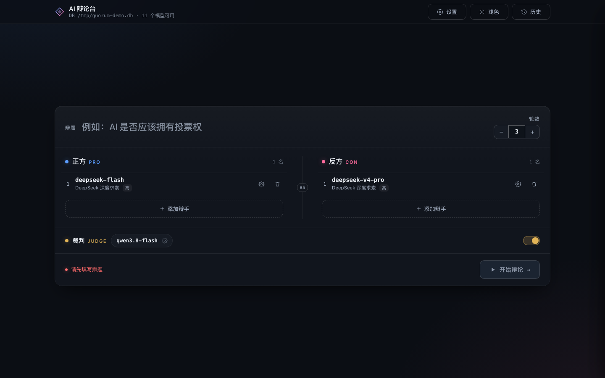

# AI Quorum — 多模型圆桌讨论

让**不同的大模型**围绕同一个议题独立表态、互相质询，最后收敛出一份带分歧标注的结论。云端模型（DeepSeek / OpenAI / Anthropic / Gemini / Grok / OpenRouter）与本地模型（LM Studio / Ollama / llama-swap / vLLM）可以混在同一场讨论里。

- **真的对辩**：正反两方逐轮交替发言，能看到对方上一轮的论点并针对性反驳，不是各说各话
- **七种收敛方法**：standard / oxford / advocate / socratic / delphi / brainstorm / tradeoff
- **分歧显式化**：报告区分共识、分歧、未解决项，不做表面和谐
- **Web 辩论台**：一张卡配完正反辩手与裁判，流式对辩 + 裁决卡 + 历史回放 + 深浅主题
- **本地优先**：环境变量里的 key 从 `~/.quorum/.env` 读取；界面新增模型时填的 key 存本机 SQLite（明文，文件权限 0644），不回传前端；模型库同样在本机，不经过任何中间服务器
- **OpenAI 兼容**：任何实现了 `/v1/chat/completions` 的服务都能接入，含本地推理



## 快速开始

```bash
git clone <repo-url> ai-quorum && cd ai-quorum
uv sync                                 # 依赖装进项目内 .venv，不污染系统 Python
mkdir -p ~/.quorum && cp .env.example ~/.quorum/.env   # 至少填一个厂商的 API Key
uv run debate                           # 打开 http://127.0.0.1:8770
```

要求 Python ≥ 3.12，用 [uv](https://docs.astral.sh/uv/) 管理。

命令行版本：

```bash
uv run aiq "该不该读博" -m deepseek-flash,deepseek-v4-pro -M oxford
```

## 辩论台（Web）：`debate`

```bash
debate                       # http://127.0.0.1:8770
debate --port 9000           # 指定端口
debate --no-browser          # 不自动开浏览器
debate --db /tmp/demo.db     # 指定 SQLite
```

浏览器里完成全部操作，**主界面就是对阵台**：

```
            ┌── 辩题 ───────────────────────── 轮数 ──┐
            └──────────────────────────────────────────┘
   ┌── 正方 PRO ─────────┐   VS   ┌── 反方 CON ─────────┐
   │ ① deepseek-flash ⚙ ✕│        │ ① deepseek-v4-pro ⚙ ✕│
   │ + 添加正方辩手       │        │ + 添加反方辩手        │
   └──────────────────────┘        └───────────────────────┘
            ┌── 裁判 JUDGE ─────────────── [开关] ──┐
            └───────────────────────────────────────┘
                     [ 开始辩论 ]  校验提示
```

- **两列对阵**：正方、反方各一列，左侧蓝点、右侧粉点，中间 `VS` 分隔。槽位行只显示模型名与厂商，不堆下拉框。
- **顶栏只有三个入口**：设置、日夜模式切换（日/月图标，选择会记住）、历史。
- **添加辩手 = 选模型弹窗**：点「+ 添加辩手」弹出已添加模型清单（可搜索过滤），选中确认才入列。
- **齿轮调单个席位**：每个席位右侧齿轮，点开弹层改「模型 / 思考强度 / 私有提示词」。
- **设置 → 模型管理**：独立界面管理全部模型——搜索、删除、新增；新增模型支持**厂商下拉**（17 家预设，选中自动带出 Base URL）与**一键获取模型清单**（调用该服务的 `/v1/models`，本地服务同样适用）。
- **辩题 + 轮数**：放在顶部同一块面板，轮数 1–12。
- **默认槽位**：首屏从 `~/.quorum/.env` 推导——正反各取一个已配置模型，裁判取第三个不同的模型，不用手动配。
- **同一模型拆成两支**：允许正反重复选同一个模型，配两份对立提示词互搏。
- **偶数人制**：正反各若干名，总数必须偶数；每轮按「正方全员 → 反方全员」交替发言。
- **运行即专注**：点开始后配置区收起，舞台占满；结束后出现「返回配置 / 重新开始」。
- **裁判裁决**：判定结果做成卡片——大字判定 + 四宫格（双方最强论点 / 最大漏洞）+ 判定理由 + 结论。
- **历史记录**：会话与发言落 SQLite（`~/.quorum/web.db`），可回看、可删除；刷新页面能接回进行中的场次。

界面见 `docs/screenshots/`：`01-config`（对阵台）、`02-slot-editor`（席位齿轮 → 新建模型表单）、`03-running`（流式对辩）、`04-verdict`（裁决卡）、`05-history`（历史）、`06-mobile`（窄屏）、`07-model-dropdown`（席位模型下拉）、`08-fetch-models`（新增模型 · 一键获取）、`09-pick-modal`（添加辩手选模型）、`10-settings`（设置抽屉）、`11-light-theme`（浅色）`12-models-modal`（模型管理界面）`13-mobile-models`（窄屏模型管理）。

配色与可读性按 WCAG 2.1 审计校准过（`docs/design-audit.md`）：正文对比度全部 ≥4.5:1，表单控件静止态边界 ≥3:1，禁用态用显式配色而非透明度。

技术：FastAPI + SSE 流式推送，前端单文件、零外链、离线可用。

终端版仍保留：

```bash
debate-cli                    # 原交互式双人对话（输入辩题与双方提示词）
```

## 厂商预设

内置 17 家 provider，选厂商即带出默认 Base URL 与常用模型名，不用手抄 endpoint：

| 国产 | Base URL | 常见模型 |
| --- | --- | --- |
| DeepSeek 深度求索 | `api.deepseek.com/v1` | deepseek-flash / deepseek-v4-pro |
| 智谱 GLM | `open.bigmodel.cn/api/paas/v4` | glm-4.6 / glm-4.5 / glm-4.5-air / glm-4.5-flash |
| MiniMax | `api.minimax.chat/v1` | MiniMax-M2 / MiniMax-Text-01 |
| 月之暗面 Kimi | `api.moonshot.cn/v1` | kimi-k2-0905-preview / moonshot-v1-128k |
| 阿里通义千问 | `dashscope.aliyuncs.com/compatible-mode/v1` | qwen3-max / qwen-plus / qwen-turbo |
| 硅基流动 | `api.siliconflow.cn/v1` | DeepSeek-V3.2-Exp / Qwen3-235B / Kimi-K2 |
| 火山方舟（豆包） | `ark.cn-beijing.volces.com/api/v3` | doubao-seed-1.6 / doubao-1.5-pro-32k |
| 阶跃星辰 | `api.stepfun.com/v1` | step-2-16k |
| 百川智能 | `api.baichuan-ai.com/v1` | Baichuan4-Turbo / Baichuan4 |

海外与本地：OpenAI / Anthropic / Gemini / Grok / OpenRouter / LM Studio / llama-swap / Ollama。

`.env` 里填了哪家的 key，它就会自动出现在可选模型里；没填 key 的厂商仍在「新增模型」列表中可见，选中时要求填入 key（存本机 SQLite，不回传前端）。`GLM_API_KEY` / `ZHIPU_API_KEY`、`MOONSHOT_API_KEY` / `KIMI_API_KEY` 这类同厂别名都识别。

首屏槽位由 `/api/bootstrap` 的 `default_slots` 生成：正反各取一个已配置的模型，裁判取第三个（避免与辩手同源），全部从 `~/.quorum/.env` 推导，不用手动配置。

## 为什么不是「问一个模型两遍」

单模型多次采样是同一个先验的自言自语；不同厂商的模型在训练数据、对齐策略、知识截止上互不相同，互相质询时才会暴露真正的分歧点。这套工具把「分歧」当作一等公民：报告里显式区分共识、分歧、未解决项。

## 配置

优先级：`--env <path>` > 当前目录 `.env` > `~/.quorum/.env`。字段名与 Quorum 原生配置兼容，因此可以直接复用已有的 `~/.quorum/.env`。

- 云端 provider 必须同时有 API key 和模型列表才生效；占位符（`sk-...`）会被自动忽略。
- 本地 provider 无需配置模型列表，启动时自动探测 `/v1/models`（Ollama 走 `/api/tags`）。
- 本地请求自动 `trust_env=False`，避免被系统代理劫持。

完整字段见 `.env.example`。

## 用法

```bash
# 列出可用模型 / 方法
uv run aiq --list-models
uv run aiq --list-methods

# 只看讨论计划，不调用模型
uv run aiq "议题" -m 1,2 -M delphi --dry-run

# 指定模型与轮数
uv run aiq "远程办公该不该成为默认" -m deepseek-flash,deepseek-v4-pro -M standard -r 2

# 混合本地模型（LM Studio 需先加载模型）
uv run aiq "该不该读博" -m deepseek-flash,gemma-4-e2b -M advocate

# 强制串行（显存紧张时）
uv run aiq "议题" -m 1,2,3 -M brainstorm --sequential
```

模型选择支持三种写法：序号（`1,3`、`1-3`）、模型名（`deepseek-flash`）、provider 前缀（`lmstudio:qwen3.5-4b`）。

### 参数

| 参数 | 说明 |
| --- | --- |
| `-m/--models` | 模型：序号 / 名称 / `all` |
| `-M/--method` | 讨论方法，默认 `standard` |
| `-r/--rounds` | 讨论轮数，默认读 `QUORUM_ROUNDS_PER_AGENT` |
| `-s/--synth` | 综合者：序号 / 模型名 / `first` / `random` |
| `--timeout` | 单模型超时秒数 |
| `--max-tokens` | 单条发言额度 |
| `--output-dir` | 报告目录，默认 `~/reports` |
| `--format` | `md` / `text` / `json` |
| `--sequential` / `--parallel` | 覆盖并发策略 |
| `--dry-run` | 只打印 Step 计划 |
| `-v/--verbose` | 显示每条发言的 token 与耗时 |

## 七种讨论方法

| 方法 | 最少模型 | 结构 |
| --- | --- | --- |
| `standard` 标准圆桌 | 2 | 独立陈述 → N 轮互质 → 综合 |
| `oxford` 牛津辩论 | 2（偶数） | 正反平分 → 立论 → 交替反驳 → 交叉质询 → 结辩 → 裁判点评 |
| `advocate` 魔鬼代言人 | 3 | 独立方案 → 收敛共识 → 一人全力攻击 → 辩护 → 修订结论 |
| `socratic` 苏格拉底追问 | 2 | 提问者连追三轮，专挑模糊与矛盾 → 收束 |
| `delphi` 德尔菲评估 | 3 | 匿名估计 → 匿名互评 → 二次估计 → 中位数与分歧汇总 |
| `brainstorm` 头脑风暴 | 2 | 禁止评价地发散 → 基于他人点子构建 → 聚类排 Top3 |
| `tradeoff` 权衡对比 | 2 | 拆备选方案与维度 → 逐维打分 → 对比表 + 翻转条件 |

方法内部结构固定（`oxford` / `socratic` / `delphi` 不受 `--rounds` 影响）。

## 输出

每场讨论自动落盘到 `~/reports`：YAML front matter + 参与者表 + 按阶段分组的完整发言 + 结论。失败的调用不会被吞掉，报告里保留 `⚠️ 调用失败：<原因>`。

## 架构

```
quorum/
  types.py      # 数据结构：ModelSpec / Agent / Step / Utterance / DiscussionResult
  config.py     # .env 解析、provider 表、本地探测、模型解析
  providers.py  # 统一流式客户端（OpenAI 兼容 + Anthropic 原生），重试与 token 统计
  methods.py    # 七种讨论方法 => Step 计划
  engine.py     # 执行器：prompt 组装、并发控制、历史截断、失败降级
  report.py     # md / text / json 导出
  cli.py        # aiq：交互向导 + 一次性执行
  debate.py     # debate-cli：终端版双人对话
  webapp.py     # debate：起 Web 服务、映射端口、自动开浏览器
  web/
    app.py      # FastAPI 路由 + SSE 推流 + 模型目录（含 30s 缓存）
    store.py    # SQLite：自定义模型 / 会话 / 参与者 / 发言
    runner.py   # 多对多辩论执行、思考强度透传、裁判裁决解析
    static/index.html   # 单页前端（内联 CSS/JS，零外链，离线可用）
```

界面见 `docs/screenshots/`（配置页、裁决卡、历史抽屉、新增模型）。

Web 层的关键设计：

| 关注点 | 做法 |
| --- | --- |
| 实时输出 | SSE（`/api/debate/{sid}/stream`），`delta` 增量 + `message` 完整内容双轨，前端用 `message` 兜底纠偏 |
| 私密性 | 每次调用重建 messages，只含本席位私有 prompt + 辩题 + 公开发言；他人的 prompt 不进别的模型的请求；prompt 本身会随会话落库并在历史详情里返回 |
| 思考强度 | `reasoning_effort`，仅对声明支持的 provider 发送；400 时自动去参重试 |
| 断线/刷新 | 事件缓冲 + 会话落库，重连先回放已完成的发言；进程重启后残留 running 会话标记为 error |
| 并发安全 | 每场一个后台线程 + 多订阅者队列；删除会话前先 stop 并 join，避免孤儿写入 |
| 容错 | 单次发言失败不影响整场，错误原件写进消息并在前端红框展示；传输层最多重试 3 次 |

分层原则：**方法只描述「谁说、什么角色、做什么」，引擎负责「怎么把历史喂给它」**。因此新增一种讨论结构只需在 `methods.py` 注册一个 `MethodSpec`，不触碰引擎与渲染。

### 新增讨论方法

```python
def _build_mymethod(topic, agents, rounds=2, synthesizer_index=0):
    return [
        Step(0, "开题", "主问", "提出三个关键问题", visibility="none", group=1),
        *[Step(i, "讨论", "参与者", "回应上一位并补充论据") for i in range(len(agents))],
        Step(synthesizer_index, "结论", "总结者", "给出 5 条可执行结论"),
    ]

METHODS["mymethod"] = MethodSpec(
    name="mymethod", title="自定义", description="...",
    min_agents=2, build=_build_mymethod,
)
```

### 新增 provider

在 `config.PROVIDER_DEFS` 里加一条（`base_url` / `key_env` / `models_env`）。只要服务兼容 OpenAI 的 `/chat/completions`，无需改客户端。

## 已知限制

- **推理类本地模型**（部分 Qwen3 微调）只输出 `reasoning_content`、不产出正文。引擎会自动加倍 token 重试一次，仍失败则在报告里标注原因——换模型或关闭 thinking 即可。
- 并行只在「独立首轮」阶段生效，互相引用的发言必须串行，否则后发者看不到前者内容。
- 历史窗口默认 24k 字符（`QUORUM_MAX_HISTORY_CHARS` 可调），超出时丢弃较早发言并标注；单条发言自身超限则截断该条。
- 未实现 `/export pdf`；需要时用 `pandoc` 后处理 markdown。

## 目录结构

```
quorum/
  debate.py      终端版双人辩论（独立实现，不走 Engine）
  engine.py      执行器：prompt 组装、并发控制、历史截断
  providers.py   OpenAI 兼容客户端封装
  methods.py     七种讨论方法的提示词与流程
  report.py      md / text / json 导出（共识与分歧由综合步骤的提示词产出，report 只负责排版）
  render.py      终端渲染
  config.py      厂商预设、.env 解析、模型发现
  web/
    app.py       FastAPI 路由（会话 / SSE 流 / 模型库）
    store.py     SQLite（模型、会话、隐藏列表）
    static/index.html   单文件前端（零外链、无构建）
tests/           161 条 pytest（引擎、方法、传输、API、存储、配置、导出）
docs/            设计审计、主题变量表、界面截图
```

## 测试

```bash
uv run pytest tests -q     # 161 passed
```

## 许可证

MIT © 2026 Chen Xinyu
